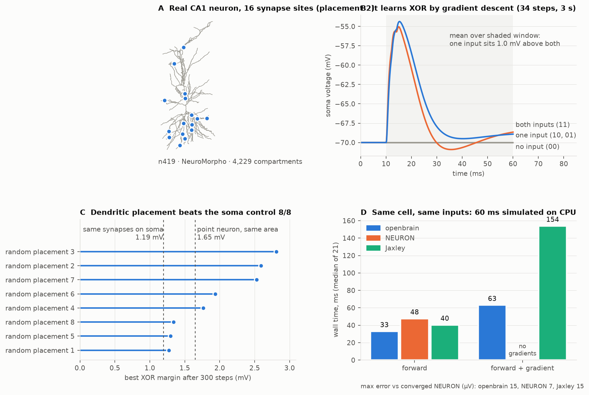

# openbrain

[](https://github.com/Fs1lyric/openbrain/actions/workflows/ci.yml)

A differentiable biophysical neuron simulator with a Rust core and a Python API. It trains the
synapses of real reconstructed neurons by gradient descent, through the full cable equations, and
checks every model against published results and against NEURON.



- **A real neuron learns XOR in seconds.** A CA1 pyramidal cell from NeuroMorpho (4,229
  compartments, 96 AMPA/NMDA/GABA_A synapses) learns XOR from exact adjoint gradients in 34–98
  steps, 9–23 CPU-seconds, on every seed tried.
- **Where synapses sit matters, and the control is reported honestly.** Placing the same
  synapses on dendrites beats putting them all on the soma in 8 of 8 random placements (1.3–2.8 mV
  vs 1.2 mV margin). A point neuron of matched area reaches 1.65 mV, so dendrites help but are not
  required for this readout. Details in [the write-up](docs/writeup.md).
- **Fast and accurate on CPU.** On the identical cable, openbrain runs 1.4× faster than NEURON and
  computes gradients 2.4× faster than Jaxley, within 15 µV of a converged reference.

| Same cell, same inputs, 60 ms | forward | forward + gradient | max error vs reference |
| --- | --- | --- | --- |
| **openbrain** (Rust, 1 thread) | **33 ms** | **63 ms** | 15 µV |
| NEURON 9.0.2 | 48 ms | — | 7 µV |
| Jaxley 0.14.0 (CPU, after a 1–2 s JIT) | 40 ms | 154 ms | 15 µV |

Reproduce with `bench/` (see [the write-up](docs/writeup.md#reproduce)).

## Models

| Tier | Model | Engine | Use it for |
| --- | --- | --- | --- |
| Biophysical | Hodgkin–Huxley (1952) | Rust | ion channels, drugs, temperature, spike mechanics |
| Morphological | passive cable on SWC trees (Hines solver), AMPA, NMDA (Mg²⁺ block), GABA_A and current synapses, exact adjoint gradients | Rust | dendritic computation, learning in single neurons |
| Fast | Izhikevich (2003) | NumPy | large networks, STDP learning, population rhythms |

## Validation

Each model is held to its published behaviour by the test suite (`tests/hh.rs`):

| Property | Expected | Source |
| --- | --- | --- |
| Resting potential | −65 mV, stable | Hodgkin & Huxley 1952 |
| Spike peak | between +20 and +50 mV, below E_Na | Hodgkin & Huxley 1952 |
| Rate at 10 µA/cm² | ~68 Hz | standard HH f–I curve |
| Excitability class | type II: firing starts abruptly at > 40 Hz | Rinzel & Ermentrout 1989 |
| Temperature | Q10 = 3 speeds firing | Hodgkin & Huxley 1952 |
| Sodium block (TTX) | no action potentials | pharmacology |
| Numerics | spike times converge as dt → 0 | |

Ten seconds of simulated HH activity (1M time steps) run in about 0.2 s.


The cable and synapse code is held to its own checks (`tests/cable.rs`, `tests/learn.rs`,
`tests/xor.rs`): adjoint gradients match central finite differences to 1e-6, NMDA input sums
supralinearly where AMPA does not, and current synapses reproduce direct current injection exactly.

## Quick start

Needs Rust (stable) and [uv](https://docs.astral.sh/uv/).

```sh
uv sync                                   # builds the Rust extension
uv run openbrain cortex --raster raster.png
```

```python
import numpy as np
from openbrain import HHNeuron

control = HHNeuron().simulate(np.full(10_000, 10.0), dt=0.01)  # 100 ms at 10 µA/cm²
ttx = HHNeuron(g_na=0.0).simulate(np.full(10_000, 10.0))     # sodium channels blocked
print(control.spike_times, ttx.spike_times)
```

## Roadmap

1. ~~Hodgkin–Huxley neurons in Rust with a Python API~~
2. ~~Morphologically detailed neurons: SWC morphologies and the Hines cable solver~~
3. ~~Conductance-based synapses (AMPA, NMDA with Mg²⁺ block, GABA_A)~~
4. ~~Exact gradients (discrete adjoint) and learning in a real neuron~~
5. ~~Benchmarks against NEURON and Jaxley~~; cross-validation against NEURON in CI
6. Active dendrites, then the Neuron Compute Atlas: learning capacity across 1,000+ real cells
   ([research plan](docs/research/plan.md))

## Development

```sh
cargo test && cargo clippy --all-targets --features python -- -D warnings
uv run pytest && uv run ruff check .
```

## License

MIT
