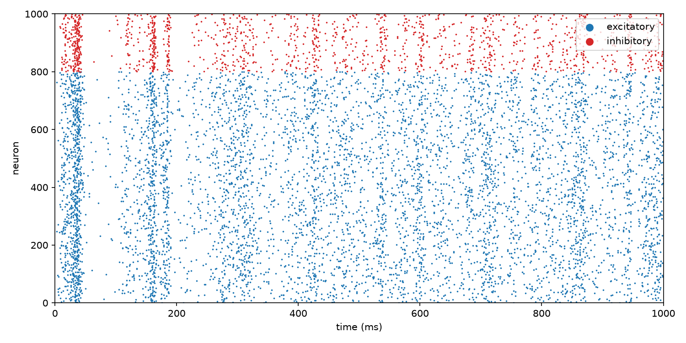

# openbrain

An open-source spiking brain simulator. Small, readable, and built to grow from a
1000-neuron cortex toward simulating real wiring diagrams.



## What's in it

- **Neurons:** Izhikevich (2003) model, vectorised, with the classic cell types
  (`RS`, `IB`, `CH`, `FS`, `LTS`, `TC`, `RZ`).
- **Networks:** weights `W[post, pre]`, thalamic noise, 1 ms steps, spike recording.
- **Learning:** pair-based STDP on excitatory synapses.
- **Connectomes:** load any `pre,post,weight` CSV and drive chosen neurons.

## Quick start

```sh
uv sync
uv run openbrain cortex --raster raster.png          # Izhikevich's 1000-neuron cortex
uv run openbrain cortex --plastic --ms 5000          # same, with STDP learning
uv run openbrain connectome edges.csv --stimulate AVAL --scale 5
```

```python
from openbrain import build_cortex

record = build_cortex(seed=0).run(1000)
print(record.rates().mean(), "Hz")
```

## Development

```sh
uv run pytest
uv run ruff check . && uv run ruff format --check .
```

## License

MIT
