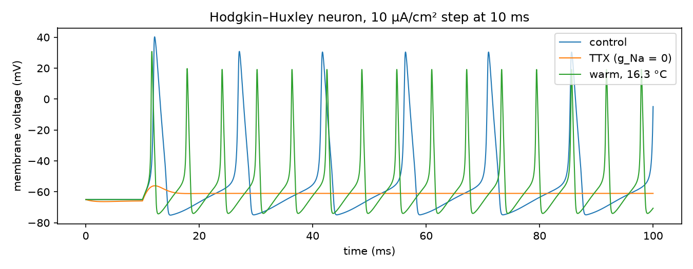

# openbrain

[](https://github.com/Fs1lyric/openbrain/actions/workflows/ci.yml)

A biophysical neuron simulator with a Rust core and a Python API. It models neurons the way
neuroscientists do, with ion channels, conductances and membrane equations, and validates every
model against published results.



## Models

| Tier | Model | Engine | Use it for |
| --- | --- | --- | --- |
| Biophysical | Hodgkin–Huxley (1952) | Rust | ion channels, drugs, temperature, spike mechanics |
| Fast | Izhikevich (2003) | NumPy | large networks, STDP learning, population rhythms |

## Validation

Each model is held to its published behaviour by the test suite (`tests/hh.rs`):

| Property | Expected | Source |
| --- | --- | --- |
| Resting potential | −65 mV, stable | Hodgkin & Huxley 1952 |
| Spike peak | between +20 and +50 mV, below E_Na | Hodgkin & Huxley 1952 |
| Rate at 10 µA/cm² | ~68 Hz | standard HH f–I curve |
| Excitability class | type II: firing starts abruptly at > 40 Hz | Rinzel & Ermentrout 1989 |
| Temperature | Q10 = 3 speeds firing | Hodgkin & Huxley 1952 |
| Sodium block (TTX) | no action potentials | pharmacology |
| Numerics | spike times converge as dt → 0 | |

Ten seconds of simulated HH activity (1M time steps) run in about 0.2 s.

## Quick start

Needs Rust (stable) and [uv](https://docs.astral.sh/uv/).

```sh
uv sync                                   # builds the Rust extension
uv run openbrain cortex --raster raster.png
```

```python
import numpy as np
from openbrain import HHNeuron

control = HHNeuron().simulate(np.full(10_000, 10.0), dt=0.01)  # 100 ms at 10 µA/cm²
ttx = HHNeuron(g_na=0.0).simulate(np.full(10_000, 10.0))  # sodium channels blocked
print(control.spike_times, ttx.spike_times)
```

## Roadmap

1. ~~Hodgkin–Huxley neurons in Rust with a Python API~~
2. Morphologically detailed neurons: SWC morphologies and the Hines cable solver
3. Conductance-based synapses (AMPA, NMDA with Mg²⁺ block, GABA_A) and delays
4. Gradients via dual numbers: fit channel parameters to recordings by gradient descent
5. Cross-validation against NEURON in CI, and benchmarks against NEURON and Brian2

## Development

```sh
cargo test && cargo clippy --all-targets --features python -- -D warnings
uv run pytest && uv run ruff check .
```

## License

MIT
